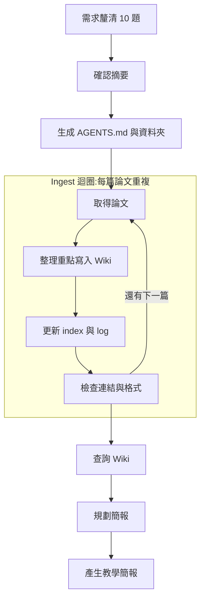

# 投資風險衡量 LLM Wiki

依 Karpathy 的 LLM Wiki 構想,把投資風險衡量的經典論文整理成可持續維護的 markdown 知識庫。第一版聚焦在風險指標(VaR、ES/CVaR、Sharpe ratio、最大回撤)的假設、優缺點與適用情境比較。

## 從這裡開始

- [wiki/index.md](wiki/index.md):內容目錄
- [wiki/overview.md](wiki/overview.md):整體綜述、爭議與資料缺口
- [wiki/comparisons/risk-metrics-comparison.md](wiki/comparisons/risk-metrics-comparison.md):四種指標總比較
- [AGENTS.md](AGENTS.md):Agent 的工作規範(頁面模板、出處標註、ingest / query / lint 流程)
- 教學簡報:https://claude.ai/artifact/X1tYwyXWwQr4K1spMCeQX2 (需設定分享後才能開啟)

## 資料夾結構

| 路徑 | 說明 |
|---|---|
| `raw/` | 原始論文 PDF,Agent 只讀不改(目前為空,PDF 因版權不上傳) |
| `wiki/sources/` | 每篇論文一頁摘要(6 篇) |
| `wiki/metrics/` | 每個風險指標一頁(4 頁) |
| `wiki/concepts/` | 支撐概念(3 頁) |
| `wiki/comparisons/` | 指標之間的比較(2 頁) |
| `wiki/log.md` | 時間序操作紀錄 |

## 主流程

## 使用的限制

- 內容取自公開網頁版本,部分為預印本或工作稿,各論文頁的 `version_read` 有記錄。
- 最大回撤那篇只讀到摘要,細節標〔待核對〕。
- 標〔待核對〕、〔二手資料〕、〔背景知識〕、〔Agent 推論〕之處,不是直接來自論文全文。
